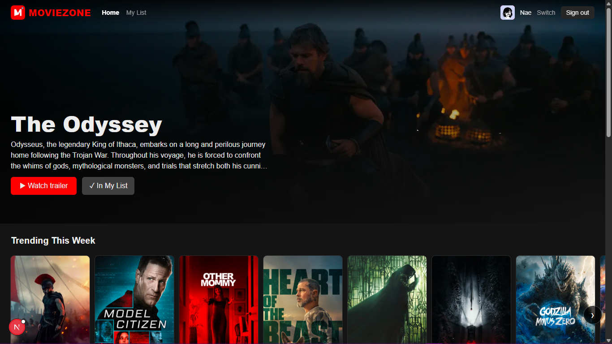
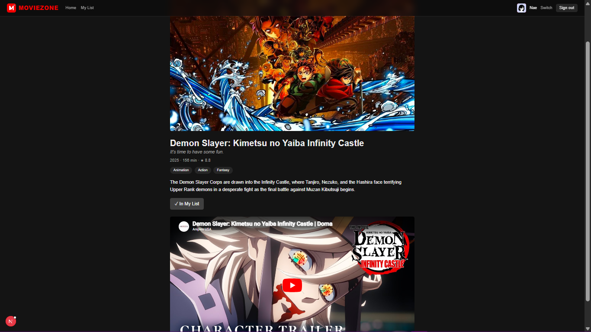
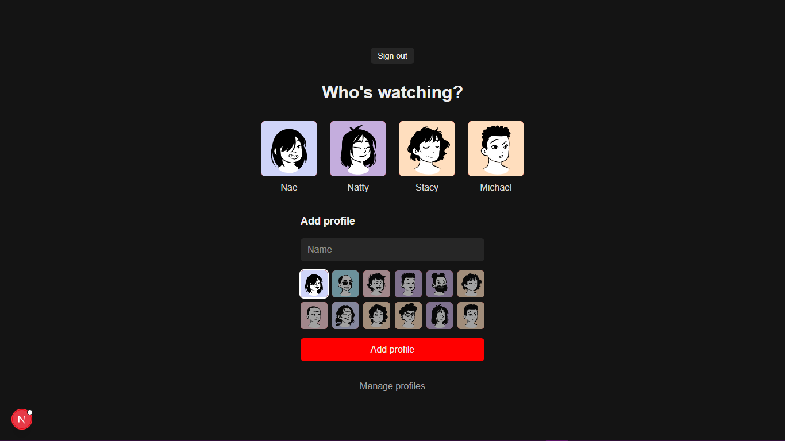
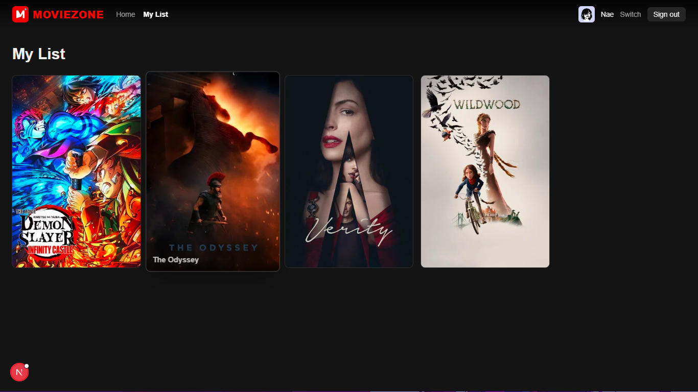
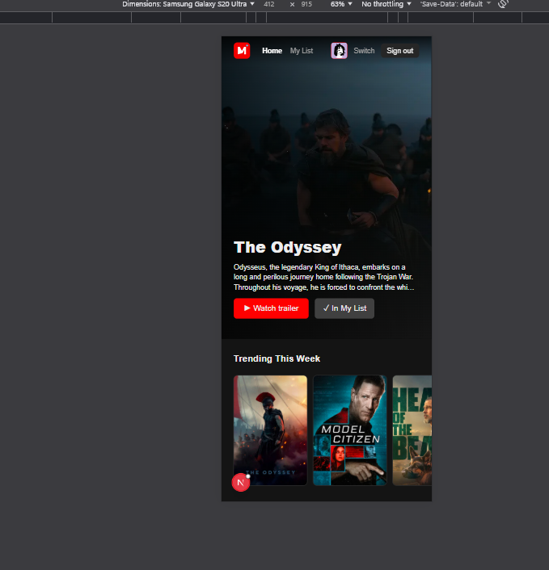

# 🎬 MovieZone

A streaming-style movie browser: sign in, pick a profile, browse trending films, watch trailers, and save movies to your own list.

**Live demo:** https://netflix-clone-six-xi-23.vercel.app/



> Educational portfolio project. Not affiliated with Netflix. This product uses the TMDB API but is not endorsed or certified by TMDB.

## Features

- Email and Google sign-in (Supabase Auth) with email confirmation
- "Who's watching?" profiles: create up to 5, rename, change avatar, delete
- Hero banner and horizontally scrolling rows: Trending, Popular, Top Rated, Coming Soon
- Movie details page with genres, runtime, rating, and embedded trailer
- Personal "My List" saved per profile, with instant add/remove
- Protected routes: signed-out visitors are redirected to the login page
- Loading skeletons, error boundary, and a custom 404 page
- Responsive layout, from phones to desktop

## Screenshots

| Movie details | Profiles |
| --- | --- |
|  |  |

| My List | Mobile |
| --- | --- |
|  |  |

## Tech stack

- **Framework:** Next.js (App Router), React, TypeScript
- **Styling:** Tailwind CSS
- **Auth and database:** Supabase (Postgres with Row Level Security)
- **Forms and validation:** React Hook Form and Zod
- **Data:** TMDB API
- **Avatars:** DiceBear (Lorelei style)
- **Hosting:** Vercel

## Getting started

### Prerequisites

- Node.js 20.9 or newer
- pnpm (`npm i -g pnpm`)
- A free [TMDB](https://www.themoviedb.org/settings/api) account (Read Access Token)
- A free [Supabase](https://supabase.com) project

### Setup

```bash
git clone https://github.com/QueenNatty/netflix-clone.git
cd netflix-clone
pnpm install
cp .env.example .env.local
```

Fill in `.env.local`:

| Variable | Where to find it |
| --- | --- |
| `TMDB_ACCESS_TOKEN` | TMDB → Settings → API → Read Access Token |
| `TMDB_BASE_URL` | `https://api.themoviedb.org/3` |
| `NEXT_PUBLIC_TMDB_IMAGE_BASE_URL` | `https://image.tmdb.org/t/p` |
| `NEXT_PUBLIC_SUPABASE_URL` | Supabase → Project Settings → API |
| `NEXT_PUBLIC_SUPABASE_PUBLISHABLE_KEY` | Supabase → Project Settings → API |

### Database

1. In Supabase, open **SQL Editor**, paste the contents of [`supabase/schema.sql`](supabase/schema.sql), and run it.
2. Go to **Authentication → URL Configuration**. Set **Site URL** to `http://localhost:3000` and add `http://localhost:3000/**` to **Redirect URLs**.
3. Optional: for faster local testing, turn off **Confirm email** under **Authentication → Providers → Email**.
4. Optional: to enable Google sign-in, add a Google OAuth client under **Authentication → Providers → Google**.

### Run

```bash
pnpm dev
```

Open http://localhost:3000.

## Project structure

```text
src/
  app/
    (app)/          pages with the navbar: home, movie details, my list
    login/ signup/  authentication pages
    profiles/       "Who's watching?" and profile management
    watchlist/      server actions for My List
    auth/callback/  OAuth and email confirmation handler
  components/       UI components
  lib/              TMDB client, Supabase clients, validation schemas
  proxy.ts          route protection
supabase/
  schema.sql        database tables and security policies
```

## Engineering notes

- **Secrets stay on the server.** The TMDB token is only read in server-only modules, so it never reaches the browser.
- **Security lives in the database.** Row Level Security policies ensure users can only read and change their own profiles and lists, even if the public key is exposed.
- **Never trust the client.** Server actions re-validate every input with Zod and look up movie data themselves instead of accepting it from the browser.
- **Fast pages.** Independent TMDB requests run in parallel, responses are cached for an hour, and slow sections stream in behind loading skeletons.

## Known limitations

- Google sign-in is limited to approved test users while the Google app is unpublished.
- Avatars come from a fixed preset list (uploading your own is planned).

## Roadmap

- [x] Project setup and deployment
- [x] TMDB data layer
- [x] Movie details and trailers
- [x] Authentication and profiles
- [x] My List
- [x] Hero banner, rows, and polish
- [ ] Search
- [ ] Custom avatar uploads

## License

MIT, see [LICENSE](./LICENSE).